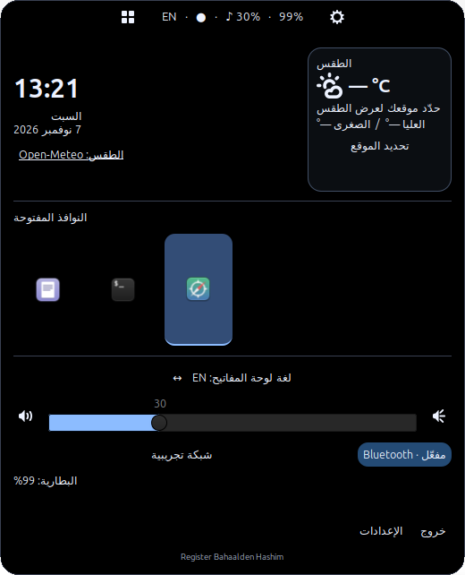

# الجزيرة العائمة — Floating Island

تطبيق فعلي خفيف لـ Linux Mint 22.3 / Xfce / X11، مكتوب بـ Python 3 وGTK 3. يعمل بجانب البار الحالي ولا يغيّر إعدادات سطح المكتب. النسخة 0.4 تجريبية؛ ليست جاهزة بعد لإلغاء البار.

## التنزيل من GitHub

```sh
git clone https://github.com/Bhasim/floating-island.git
cd floating-island
chmod +x run.sh
./run.sh
```

تأكّد من تثبيت اعتماديات النظام المذكورة أدناه. بديلًا عن Git يمكن تنزيل ZIP من زر Code ثم فكّه، وتنفيذ `chmod +x run.sh` قبل التشغيل. لا تنقل إعدادات حسابك إلى مجلد المشروع.

## التشغيل

من مجلد المشروع:

```sh
./run.sh
./run.sh --expand
./run.sh --collapse
./run.sh --settings
./run.sh --quit
```

مرّر المؤشر فوق الكبسولة لفتحها، أو انقر علامة التطبيقات أو الملخص. زر الترس يفتح الإعدادات، وزر «خروج» داخل اللوحة يوقف التطبيق. لا تُشغّله بـ root. تُمنع النسخ المتعارضة بواسطة Gtk.Application وD-Bus؛ إعادة الأمر تتحكم في النسخة الحالية. الخروج بالأمر السابق يعمل حتى إن كانت الجزيرة مخفية أثناء ملء الشاشة.

تحتاج جلسة X11 مع compositor للشفافية. لا يوجد Vulkan أو متصفح مضمّن. استخدم Python النظام `/usr/bin/python3`؛ بيئة pip افتراضية لا تتضمن بالضرورة مكتبات GI.

اعتماديات Mint/Ubuntu الأساسية، عند غيابها:

```sh
sudo apt install python3 python3-gi python3-gi-cairo python3-cairo gir1.2-gtk-3.0 gir1.2-wnck-3.0 gir1.2-nm-1.0 libx11-6 x11-utils pulseaudio-utils network-manager
```

لواجهات الاتصال والإقران والخدمات الاختيارية: `xfce4-terminal network-manager-gnome blueman bluez upower`. القائمة في `requirements-system.txt`. تحقّق من توفر الحزم قبل التشغيل.

## ما يعمل

- كبسولة داكنة أعلى الشاشة ولوحة متمددة؛ مهل قابلة للتعديل وحركة يمكن تعطيلها. حدود X11 المرئية ومنطقة الإدخال مستديرة؛ زواياها الشفافة لا تحجب النقرات. لا توجد مساحة شفافة كبيرة فوق التطبيقات.
- نافذة dock ثابتة فوق النوافذ، دون عنصر في قائمة المهام ودون سحب التركيز عند المرور. الإعدادات نافذة مستقلة تقبل الكتابة. Escape يغلق الإعدادات والقوائم التابعة عندما تتلقى المفتاح، دون اختصار عالمي.
- نوافذ التطبيقات عبر libwnck/EWMH، مع الأيقونات والعنوان واسم مساحة العمل عند المرور، وتمييز النشطة واستعادة المصغّرة وتفعيل مساحة العمل المطلوبة. كل نافذة لها أيقونتها، بما فيها النوافذ المتعددة للتطبيق نفسه. لا توجد أزرار إغلاق عرضية.
- لغة فعلية عبر XKB، مع اكتشاف التخطيطات من X11، وتحديث بالأحداث وتبديل بالنقر. يعرض التطبيق رمز XKB الحقيقي مثل `ARA` أو `DE` أو `US`؛ لا يفترض لغتين بعينهما ولا يعدّل اختصارات النظام.
- مستوى الصوت والكتم عبر pactl / PulseAudio أو PipeWire، تحديث بأحداث `pactl subscribe`، وتحديد الإخراج الافتراضي. الحد 100%. تغيير الإخراج يضبط الافتراضي؛ نقل التدفقات الموجودة يعتمد على سياسة خادم الصوت.
- NetworkManager: الحالة والشبكة وقوتها وEthernet، عرض الشبكات، طلب مسح وتشغيل راديو Wi-Fi وإيقافه دون أمر لفصل كل الشبكات. الشبكات المخفية تُدار من أداة الشبكة الحالية. الاتصال يفتح `nmcli --ask` في طرفية Xfce مستقلة للمصادقة؛ كلمات المرور لا تمر داخل التطبيق ولا ملف إعداداته أو سجله. قد يعرض NetworkManager طلب Polkit حسب صلاحيات النظام. زر التحديث يطلب المسح؛ أعد فتح القائمة لرؤية النتائج الحديثة.
- BlueZ: اكتشاف المحول، تشغيله وإيقافه، الأجهزة المقترنة والمتصلة، الاتصال والفصل، وفتح Blueman للإقران. عند تعدد المحولات يُستخدم الأول للتحكم بالطاقة وتُعرض الأجهزة المعروفة من الجميع.
- UPower: بطارية الجهاز الفعلية والنسبة والشحن والوقت عندما يكون صالحًا؛ يُخفى القسم عند غياب البطارية. لا إشعارات نظام.
- إعدادات الشاشة، الإزاحة والمسافة والعرض واللون والشفافية، الحركة والمهل، الأقسام ومساحات العمل وملء الشاشة. الحفظ الذرّي في `${XDG_CONFIG_HOME:-~/.config}/floating-island/config.json` مع صلاحية 600، ومعالجة JSON التالف والقيم غير المناسبة. عند فصل شاشة يُختار أقرب رقم متاح.

## التثبيت والإزالة

التشغيل من المصدر كافٍ. للتثبيت داخل حساب المستخدم، بعد اختبار التشغيل اليدوي:

```sh
/usr/bin/python3 scripts/install.py
~/.local/bin/floating-island
```

ينسخ البرنامج إلى `${XDG_DATA_HOME:-~/.local/share}/floating-island` ويضيف مُشغّلًا إلى `~/.local/bin` وعنصرًا لقائمة التطبيقات. لا يستخدم sudo ولا يضيف التشغيل التلقائي.

التشغيل التلقائي **اختياري بعد الاستقرار**:

```sh
/usr/bin/python3 scripts/autostart.py enable
/usr/bin/python3 scripts/autostart.py disable
```

الإزالة (من المصدر أو نسخة scripts المثبّتة):

```sh
/usr/bin/python3 scripts/uninstall.py
```

تبقى إعداداتك الشخصية، ولا تُمس ملفات Xfce. للتخلص منها اختياريًا احذف مجلد `floating-island` من XDG_CONFIG_HOME. لا تحذف مجلد المشروع إلا إذا رغبت في حذف المصدر أيضًا.

## حماية البار والاستعادة

لم يُخفَ أو يُعدّل xfce4-panel، ولم تُغيَّر الثيمات أو الاختصارات أو إعدادات الشاشات. لإيقاف الجزيرة وضمان تشغيل البار الموجود:

```sh
./run.sh --quit
/usr/bin/python3 scripts/panel.py ensure-running
```

الأمر الثاني يشغّل البار فقط إذا لم يكن موجودًا. لا يعيد ضبط إعداداته. يمكن استخدامه أيضًا من مجلد النسخة المثبّتة.

قبل أي انتقال مستقبلي إلى الجزيرة وحدها، أنشئ نسخة احتياطية:

```sh
/usr/bin/python3 scripts/panel.py backup
```

يطبع مسار نسخة بتاريخها داخل `${XDG_STATE_HOME:-~/.local/state}/floating-island`. ينسخ `xfce4-panel.xml` ومجلد إضافات panel، ويحفظ قائمة الخصائص للمرجع. لإرجاع نسخة بعد تعديل مستقبلي: سجّل الخروج من Xfce أولًا، ومن جلسة نصية انسخ XML إلى `~/.config/xfce4/xfconf/xfce-perchannel-xml/xfce4-panel.xml` ومحتوى مجلد `panel` إلى `~/.config/xfce4/panel` (مع مراعاة XDG_CONFIG_HOME إن كان مخصصًا)، ثم سجّل الدخول. لا تنسخ XML فوق إعدادات xfconfd أثناء عمله لأنه قد يكتب فوقها. لا توجد خطوة إخفاء أو انتقال نهائي تلقائية في هذه النسخة.

## أيقونات الخلفية والقيود

فحص الجهاز أظهر `org.kde.StatusNotifierWatcher` مستضافًا في إضافة systray التابعة للبار، وكذلك إضافتي `systray` و`xapp-status-plugin`. فحص selection أكد وجود مضيف XEmbed، وواجهة SNI أبلغت عن عنصرين مسجّلين. هذا مختلف عن قائمة النوافذ.

لا تستضيف الجزيرة في هذه النسخة StatusNotifierItem/AppIndicator أو XEmbed، ولا تحاول الاستحواذ على مدير tray الموجود. XEmbed عادةً يحتاج مديرًا وحيدًا لكل شاشة، ونقل أيقوناته قد يغيّر المضيف الحالي. استضافة SNI أو مرآته تحتاج تنفيذ القوائم وDBusMenu واختبار التطبيقات الحالية. لذلك قد تفقد الوصول لأيقونات برامج الخلفية لو أوقفت البار. أبقه يعمل الآن. لم تُختبر جميع أيقونات المستخدم ولم تُنسخ بياناتها إلى المشروع.

القيود الأخرى:

- لا معاينات مصوّرة ولا تثبيت مفضلة ولا مركز إشعارات ولا ميكروفون.
- لا حجز مساحة workarea أعلى الشاشة؛ قد تتداخل الكبسولة مع تبويبات/عنوان نافذة مكبّرة. عدّل الإزاحة والعرض أو أخفها أثناء ملء الشاشة.
- لا مراقبة مخصّصة لـ rfkill الخاص بـ Bluetooth؛ فشل الصلاحيات/الحظر يظهر برسالة عند إعادة فتح قائمة Bluetooth. تعذّر خدمة يعطّل القسم أو يعرض عدم توفره. تعافي NetworkManager/UPower يعتمد على وكيل D-Bus؛ تعافي BlueZ بعد إعادة تشغيله قد يحتاج إعادة تشغيل الجزيرة.
- عند فتح أداة خارجية يُمنع الانكماش حتى انتهاء العملية التي أُطلقت. إذا سلّمت الأداة التنفيذ إلى نسخة قائمة قد تنتهي العملية المباشرة مبكرًا؛ النافذة الخارجية تبقى مستقلة وقابلة للاستخدام.
- لا يوجد تعهّد بسرعة أو استهلاك محدد على أجهزة أخرى. قياسات هذا الجهاز في `docs/TESTING.md` و`docs/performance.json`.

## التحقق والتطوير

```sh
/usr/bin/python3 -m unittest discover -s tests -v
# أوقف الجزيرة أولًا، ولا تشغّل الاختبار أثناء العمل على نوافذ مهمة:
./run.sh --quit
/usr/bin/python3 tests/ui_check.py
/usr/bin/python3 scripts/benchmark.py
```

اختبار الواجهة يستخدم GTK وXTest الحقيقيين، يحرّك المؤشر ويفتح نافذة اختبار وينقلها بين مساحات العمل ويختبر ملء الشاشة، ثم يحاول إعادة النافذة النشطة الأصلية. لا يبدّل الشبكة أو Bluetooth أو الصوت. القياس يحرّك المؤشر مؤقتًا خارج الجزيرة ويعيده، ويتحكم في فتحها وانكماشها. يحتاج أيضًا `wmctrl` و`libxtst6`.

الهيكل: `island/app.py` للواجهة، `services.py` لتكاملات النظام، `config.py` للإعدادات. المصدر جديد ولم يُنسخ كود من مستودعات خارجية. ترخيص كود المشروع MIT؛ مكتبات GTK/libwnck/NetworkManager/X11 تُستخدم من حزم النظام وتحتفظ بتراخيصها الخاصة. مراجع الواجهات: [مصدر libwnck الرسمي](https://github.com/GNOME/libwnck)، [مواصفات XKB](https://www.x.org/releases/X11R7.7/doc/libX11/XKB/xkblib.pdf).

لقطات فعلية مقتصّة من التطبيق:





## الساعة والطقس وخصوصية الموقع (0.2)

تظهر الساعة المحلية بنظام 24 ساعة، واليوم والتاريخ العربي، وبطاقة الطقس **داخل اللوحة الموسّعة فقط**. لا تُضاف معلومات إلى الكبسولة المغلقة. بطاقة الطقس المربعة تجمع أيقونة الحالة (صافٍ/غائم/مطر/ضباب/ثلوج/عواصف)، ودرجة الحرارة الحالية، والعليا والصغرى المتوقعتين لليوم، بالدرجة المئوية. زر Bluetooth يعرض «مفعّل» بالأزرق أو «متوقف» بالرمادي، ويتحدّث عند تغيّر خصائص BlueZ؛ لا يعتمد فهم الحالة على اللون وحده.

لإعداد الطقس، افتح الجزيرة واضغط «تحديد الموقع»:

1. «تحديد موقعي تلقائيًا» يعرض طلب موافقة قبل أي اتصال بخدمة تحديد الموقع. عند القبول تتصل الجزيرة بـ ipwho.is التي ترى عنوان الإنترنت العام وتعيد موقعًا تقريبيًا. تعرض النتيجة للاختيار والتأكيد؛ الموقع غير مضمون عند استخدام VPN أو شبكات الهاتف. لا يستخدم GPS ولا يدّعي دقة GPS.
2. أو اكتب اسم المدينة داخل التطبيق واضغط «بحث»، ثم اختر النتيجة المناسبة. يُرسل نص البحث إلى خدمة Open-Meteo للبحث الجغرافي؛ لا يوجد اسم مدينة افتراضي في المصدر.
3. يُحفظ اسم المكان وإحداثياته **فقط** في إعدادات XDG الخاصة بحسابك، خارج المشروع، بصلاحية 600. لا يُحفظ عنوان الإنترنت، ولا تُسجَّل نتائج تحديد الموقع. تستطيع تغيير المكان أو حذفه بزر «حذف الموقع المحفوظ». ملف الإعدادات ليس جزءًا من Git، وأُضيفت أنماط استبعاد احتياطية لأسماء ملفات الموقع والإعدادات.
4. بعد تأكيد المكان تُرسل الإحداثيات إلى Open-Meteo لقراءة الطقس. تجري الطلبات في خيط خلفي بمهلة اتصال، وبفاصل لا يقل عن 15 دقيقة. لا تُجرى طلبات موقع تلقائية في الخلفية. تحديث الطقس الدوري والساعة يتوقفان عند انكماش اللوحة؛ الطلب الذي بدأ بالفعل قد يكتمل. تُفحص البيانات عند إعادة فتحها. عند انقطاع الإنترنت تظهر رسالة عدم التوفر أو علامة «قديم» على آخر بيانات ناجحة؛ لا تُختلق درجات حرارة.

الطقس من [Open-Meteo](https://open-meteo.com/) وبياناته وفق [ترخيص CC BY 4.0](https://open-meteo.com/en/terms). استخدام الخدمة العامة دون مفتاح مناسب للاستخدام غير التجاري ضمن شروطها وحدودها؛ النشر التجاري يحتاج مراجعة خطة الخدمة. راجع [توثيق الطقس](https://open-meteo.com/en/docs) و[توثيق تحديد الموقع التقريبي](https://ipwhois.io/documentation). لا مكتبات pip إضافية؛ الشبكة تستخدم urllib من Python.

لا تشارك ملف إعدادات حسابك أو لقطة تعرض مدينتك عند نشر المشروع. لا يقوم أي سكربت تثبيت بنسخ إعدادات الحساب إلى المصدر أو إلى التوزيعة.


## التحكم بعرض اللوحة وارتفاعها (0.3)

في الإعدادات يوجد «عرض اللوحة المفتوحة» و«ارتفاع اللوحة المفتوحة»، بالبكسل. تغييرهما يعاين المقاس فورًا؛ «حفظ» يثبته في إعدادات الحساب، و«إلغاء» يعيد المقاس السابق. العرض من 320 إلى 1600 والارتفاع من 340 إلى 1400، وتُقيَّد الأبعاد الفعلية بمساحة الشاشة الحالية حتى لا تخرج عناصر التحكم عن الشاشة.

تتكيّف الخطوط وأيقونات البرامج وأيقونات التحكم وبطاقة الطقس والمسافات والهوامش وشريط الصوت مع البعدين، مع الحفاظ على نسب الأيقونات بدل تمديدها وتشويهها. كل الأقسام المفعّلة تبقى موجودة. قائمة النوافذ تتيح التمرير عند كثرة النوافذ؛ أسماء الشبكات الطويلة تُختصر بصريًا ويظهر الاسم الكامل عند المرور. الأحجام الصغيرة تعني نصًا وأهداف نقر أصغر؛ يمكن اختيار حجم أكبر للقراءة المريحة.

إعدادا العرض والارتفاع لا يغيّران حجم الكبسولة المغلقة أو أحجام مؤشراتِها. في اختبار المقاسات الستة عادت الكبسولة إلى المقاس نفسه بعد كل إغلاق. لا تُحفظ تغييرات سطح المكتب أو البار عند تعديل هذه الخيارات.

لإعادة فحص الأحجام الفعلية دون حفظ إعداداتك:

```sh
./run.sh --quit
/usr/bin/python3 tests/sizing_check.py
```

يسجل الاختبار نتائج كل مقاس في `docs/sizing-results.json` ويلتقط صورتين دون موقع المستخدم: `docs/sizing-360x400.png` و`docs/sizing-800x740.png`. يختبر أيضًا المعاينة والإلغاء، والنقر الفعلي على زر مصغّر، والحفظ داخل مجلد مؤقت.


## صاحب المشروع ونسخة النشر

تظهر عبارة **Register Bahaalden Hashim** أسفل اللوحة المفتوحة، وتختفي مع انكماشها. هذه عبارة تعريف داخل التطبيق باسم صاحب المشروع. ترخيص المصدر MIT في `LICENSE`.

نسخة المستودع تشمل المصدر والاعتماديات والتثبيت والإزالة والاختبارات والوثائق. لا تشمل إعدادات المستخدم أو الموقع أو كلمات المرور أو نسخ إعدادات البار أو السجلات أو ملفات المصادقة. لقطات العرض تستخدم بيانات تجريبية معلنة بدل أسماء شبكات الجهاز ونوافذه. راجع `SECURITY.md` لتفاصيل الخصوصية.
